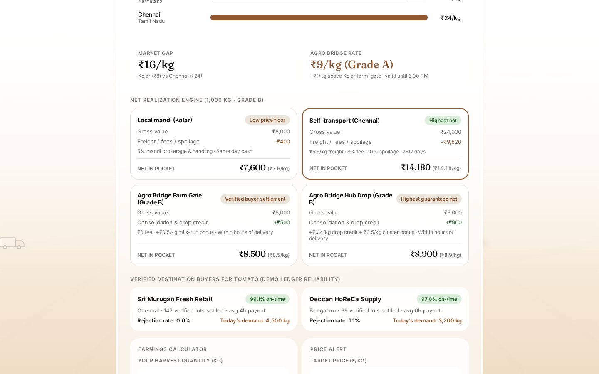
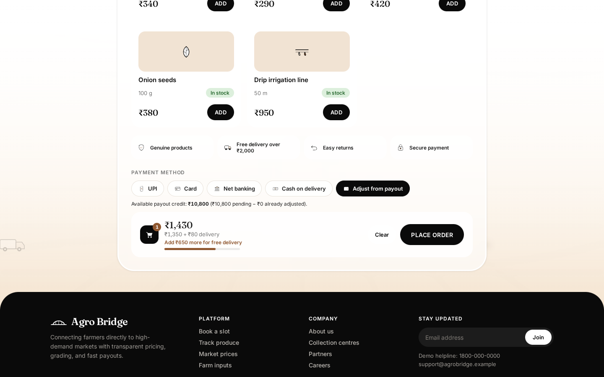

# Agro Bridge

**Bridging harvest to demand.**

Agro Bridge is an editorial, farmer-first agricultural marketplace prototype built as a self-contained single-file web application (`index.html` with inline CSS, inline JavaScript, and inline SVG line-art illustrations). It demonstrates how transparent, market-linked daily pricing, doorstep pickup scheduling, A/B/C produce grading, hub-to-market tracking, digital payouts, and farm input procurement work together to reduce post-harvest wastage and middleman opacity.

> **Demonstration Notice:** All crop rates, city mandi prices, lot statuses, farmer profiles, and transaction references in this application are demonstration figures stored strictly in memory.

---

## Key Features

- **Zero-Friction Farmer Sign-In**: Google, Email, and validated 4-digit Phone OTP demo tabs with instant profile initialization.
- **Multilingual Header & Settings (`EN`, `ಕನ್ನಡ`, `हिन्दी`, `தமிழ்`)**: Instant UI localization across navigation, screens, KPIs, and primary actions.
- **Home Dashboard (`Menu`)**: Live KPI summary (`Active lots`, `Net pending` after input deductions, `Received`, dynamic crop rate), clickable `Today’s produce rates`, action tiles, `Best markets for your crops`, crop-specific tips, and live updates feed.
- **Book a Pickup Slot (`Sell`)**: Interactive veggie & fruit crop selector (`Tomato`, `Onion`, `Potato`, `Chilli`, `Banana`), quantity (`≥50 kg`) & future-date validation, pickup point toggle (`Farm gate` / `Village collection point` hub drop credit), **Shared Milk-Run Cluster Pool** bonus progress (`1,500 kg` FTL threshold), quality checklist with live Grade A/B/C & Net Realization preview.
- **7-Stage Produce Tracker (`Track`)**: Visual dashed-road truck tracker, matched verified destination buyer, deterministic checklist-backed grading at Stage 3 with **Weighbridge & Quality Grading Evidence** (`Passed`/`Missed` audit + `Request grade review` dispute action), milk-run bonus tracking, and digital settlement receipt.
- **Net Realization Engine & Market Prices (`Market`)**: Sorted ascending city price bars (surplus green, mid black, deficit terracotta), **4-way Net Realization comparison** (Local Mandi vs Self-Transport vs Agro Bridge Farm Gate vs Agro Bridge Hub Drop after freight, commission, and spoilage), **Verified Destination Buyers** reliability scorecards, live calculator, and smart price alerts.
- **Farm Inputs Store (`Shop`)**: Category filters, inline quantity steppers, `₹2,000` free-delivery progress bar, and **Adjust from payout** credit ledger tracking (`Gross pending − Prior input deductions`) preventing double-spending.
- **Orders, Payouts & Settings**: Combined pickup slots & material orders tables, payout ledger with **Net Pending Payable** and **Estimate Accuracy** calibration (`%` predicted vs. settled), and validated `UPI` / `Bank transfer` (IFSC + 9–18 digit account) settings.

---

## Screenshots

| Farmer Dashboard | Produce Listing (Book Slot) | Order & Lot Tracking |
| --- | --- | --- |
|  |  |  |

| Market Balancing & Net Realization | Farm Inputs Store (v1 Commerce View) |
| --- | --- |
|  |  |

> Note: `screenshots/buyer-dashboard.png` captures the v1 Farm Inputs Store checkout view from the farmer-facing build. Dedicated B2B buyer portal screens are planned in [`docs/project-roadmap.md`](docs/project-roadmap.md).

---

## Repository Structure

```text
AGRO-BRIDGE/
├── README.md
├── index.html                  # Self-contained Agro Bridge web application
├── docs/
│   ├── system-architecture.md
│   ├── market-balancing.md
│   ├── business-model.md
│   └── project-roadmap.md
├── screenshots/
│   ├── farmer-dashboard.png
│   ├── buyer-dashboard.png
│   ├── produce-listing.png
│   ├── order-tracking.png
│   └── market-balancing.png
├── src/                        # Workspace starter files
├── tests/
│   └── agroBridge.test.ts      # Node test runner suite verifying pure app logic
├── LICENSE
├── CONTRIBUTING.md
├── .gitignore
├── .env.example
├── package.json
├── tsconfig.json
└── vite.config.ts
```

---

## Getting Started

### Prerequisites

- Node.js 20+ (with `npm`)

### Run Locally

```bash
npm install
npm run dev
```

Open `http://localhost:3000` in your browser. You can also open `http://localhost:3000/?autostart=1` to skip directly to the farmer dashboard.

### Build & Verify

```bash
# Run deterministic unit tests against index.html pure logic
npx --yes tsx --test tests/agroBridge.test.ts

# Typecheck
npm run lint

# Build self-contained dist/index.html
npm run build
```

---

## Documentation

- [System Architecture](docs/system-architecture.md)
- [Market Balancing Engine](docs/market-balancing.md)
- [Business Model](docs/business-model.md)
- [Project Roadmap](docs/project-roadmap.md)

---

## License

This project is licensed under the MIT License — see the [LICENSE](LICENSE) file for details.
