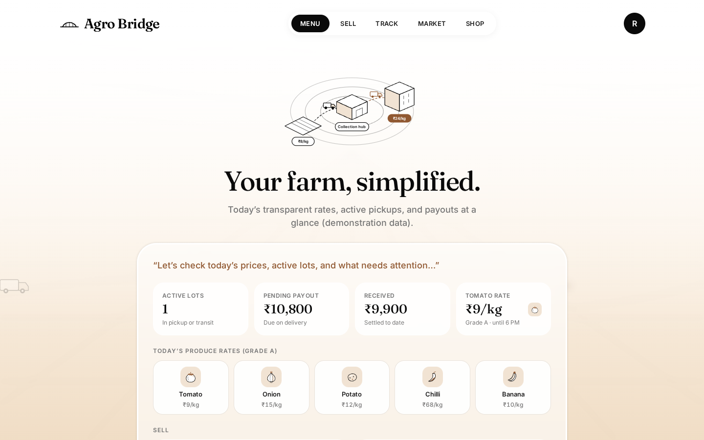
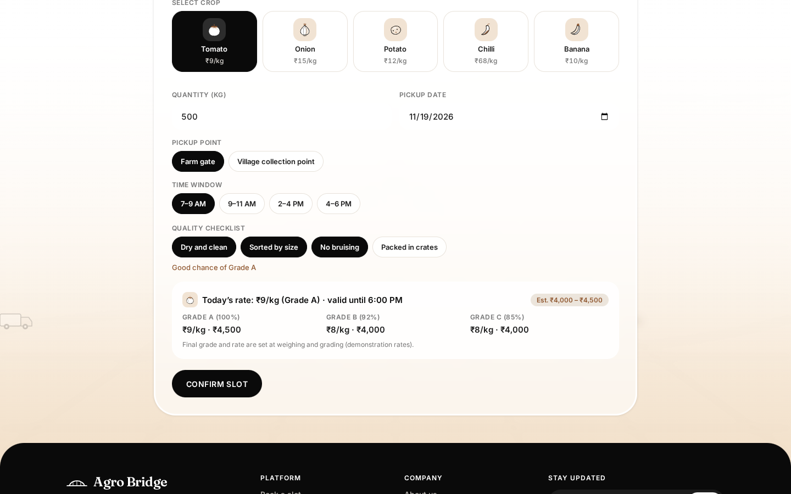
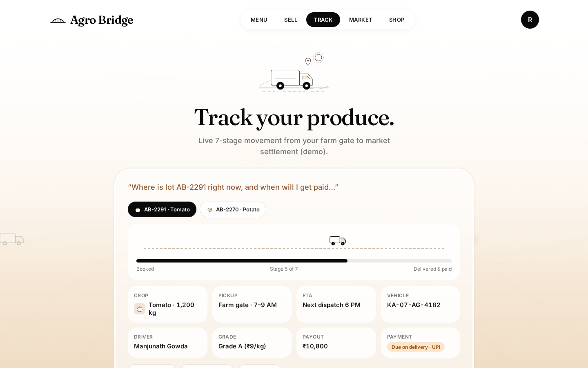

# Agro Bridge

**Bridging harvest to demand.**

Agro Bridge is an editorial, farmer-first agricultural marketplace prototype built as a self-contained single-file web application (`index.html` with inline CSS, inline JavaScript, and inline SVG line-art illustrations). It demonstrates how transparent, market-linked daily pricing, doorstep pickup scheduling, A/B/C produce grading, hub-to-market tracking, digital payouts, and farm input procurement work together to reduce post-harvest wastage and middleman opacity.

> **Demonstration Notice:** All crop rates, city mandi prices, lot statuses, farmer profiles, and transaction references in this application are demonstration figures stored strictly in memory.

---

## Key Features

- **Zero-Friction Farmer Sign-In**: Google, Email, and 4-digit Phone OTP demo tabs with instant profile initialization.
- **Home Dashboard (`Menu`)**: Live KPI summary (`Active lots`, `Pending payout`, `Received`, `Tomato rate`), clickable `Today’s produce rates`, action tiles, `Best markets for your crops`, `Tip of the day`, and updates feed.
- **Book a Pickup Slot (`Sell`)**: Interactive veggie & fruit crop selector (`Tomato`, `Onion`, `Potato`, `Chilli`, `Banana`), quantity & date inputs, pickup point toggle (`Farm gate` / `Village collection point`), 2-hour time windows, quality checklist with live Grade A/B estimation hint, and Grade A/B/C rate breakdown.
- **7-Stage Produce Tracker (`Track`)**: Visual dashed-road truck tracker, progress bar, 8 lot detail cards, quick driver/support actions, 7-step vertical journey (`Slot booked` → `Delivered & paid`), interactive demo stage advancement, and digital settlement receipt.
- **Cross-City Market Prices (`Market`)**: Sorted ascending city price bars (surplus green, mid black, deficit terracotta), market gap vs Agro Bridge rate comparison, live extra-earnings calculator, and target price alerts.
- **Farm Inputs Store (`Shop`)**: Category filters (`All`, `Fertilisers`, `Crop protection`, `Seeds`, `Irrigation`), product cards with inline quantity steppers, trust badges, ₹2,000 free-delivery progress bar, and 5 checkout payment methods including `Adjust from payout` balance validation.
- **Orders, Payouts & Settings**: Combined pickup slots & material orders tables (`Next` stage demo & `Reorder`), payout method switcher (`UPI`, `Bank transfer`, `Cash at hub`) with payment references (`UPI-xxxxxx` / `IMPS-xxxxxx` / `CASH-xxxxxx`) on settled lots, and farmer account preferences.

---

## Screenshots

| Farmer Dashboard | Produce Listing (Book Slot) | Order & Lot Tracking |
| --- | --- | --- |
|  |  |  |

| Market Balancing (City Prices) | Farm Inputs Store (v1 Commerce View) |
| --- | --- |
|  |  |

> Note: `screenshots/buyer-dashboard.png` captures the v1 Farm Inputs Store checkout view from the farmer-facing build. Dedicated B2B buyer portal screens are planned in [`docs/project-roadmap.md`](docs/project-roadmap.md).

---

## Repository Structure

```text
AGRO-BRIDGE/
├── README.md
├── index.html                  # Self-contained Agro Bridge web application
├── docs/
│   ├── system-architecture.md
│   ├── market-balancing.md
│   ├── business-model.md
│   └── project-roadmap.md
├── screenshots/
│   ├── farmer-dashboard.png
│   ├── buyer-dashboard.png
│   ├── produce-listing.png
│   ├── order-tracking.png
│   └── market-balancing.png
├── src/                        # Workspace starter files
├── tests/
│   └── agroBridge.test.ts      # Node test runner suite verifying pure app logic
├── LICENSE
├── CONTRIBUTING.md
├── .gitignore
├── .env.example
├── package.json
├── tsconfig.json
└── vite.config.ts
```

---

## Getting Started

### Prerequisites

- Node.js 20+ (with `npm`)

### Run Locally

```bash
npm install
npm run dev
```

Open `http://localhost:3000` in your browser. You can also open `http://localhost:3000/?autostart=1` to skip directly to the farmer dashboard.

### Build & Verify

```bash
# Run deterministic unit tests against index.html pure logic
npx --yes tsx --test tests/agroBridge.test.ts

# Typecheck
npm run lint

# Build self-contained dist/index.html
npm run build
```

---

## Documentation

- [System Architecture](docs/system-architecture.md)
- [Market Balancing Engine](docs/market-balancing.md)
- [Business Model](docs/business-model.md)
- [Project Roadmap](docs/project-roadmap.md)

---

## License

This project is licensed under the MIT License — see the [LICENSE](LICENSE) file for details.
